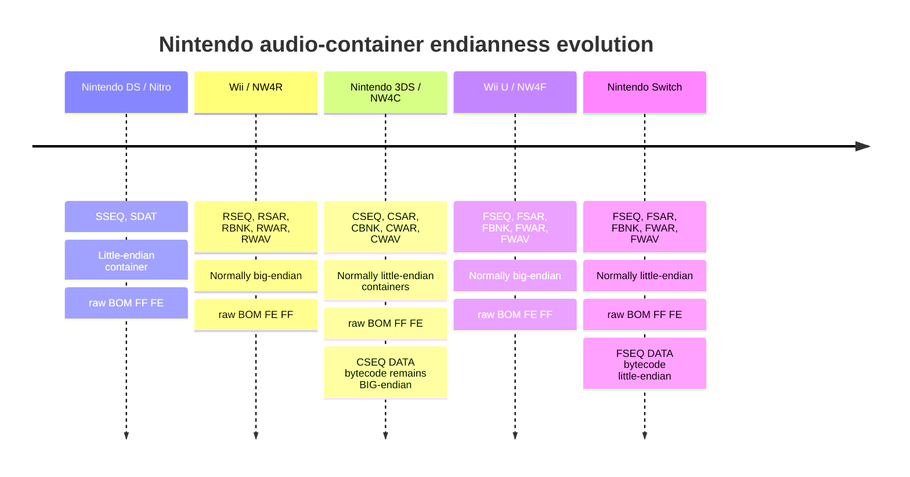

# Nintendo Sequence and Audio Container Endianness from NDS to Switch

## Executive summary

Nintendo’s audio formats form three clear endian eras: **Nintendo DS/Nitro is little-endian**, **Wii/NW4R is normally big-endian**, and the later **C/F NintendoWare family is BOM-driven**, with 3DS `C*` files normally little-endian, Wii U `F*` files normally big-endian, and Switch `F*` files normally little-endian. citeturn479574search37turn939951search1turn537446search6

The important exception is **3DS CSEQ**: its **container is normally little-endian (`FF FE`) but its raw sequence instruction stream is explicitly big-endian**; Wii U FSEQ is big/big, while Switch FSEQ is little/little. Citric Composer documents this distinction directly, so a parser must not derive sequence-bytecode endian solely from the container BOM. citeturn939951search0

## Endianness map

In the table below, **BOM bytes are the literal bytes at file offset `0x04`**, not a host-endian integer interpretation. This avoids the common ambiguity where documentation says "`0xFEFF`" while displaying raw bytes `FF FE`. Citric Composer explicitly defines raw `FE FF` as big-endian and raw `FF FE` as little-endian. citeturn939951search1

| Format | Magic | Typical platform | Container endian / raw BOM bytes | Sequence instruction endian | Version field | Notable exceptions / remarks | Primary evidence |
|---|---|---|---|---|---|---|---|
| **SSEQ** | `SSEQ` | Nintendo DS | **LE**, `FF FE` | **LE for fixed-width multibyte operands**; VLQ itself is endian-neutral | `u16`, normally semantic `0x0100`; retail example stores bytes `00 01` | Nitro format, not NW4R/C/F common header | Real SSEQ hex dump shows `SSEQ FF FE 00 01`; DS is explicitly little-endian in Nintendo DSi developer material. citeturn762530search9turn479574search37 |
| **BRSEQ / RSEQ** | `RSEQ` | Wii | **BE**, normally `FE FF` | **BE** for fixed-width operands | `u16`, interpreted in container endian | Header has fixed DATA/LABL offset-size pairs rather than modern `SizedReference[]` | MKWii BRSEQ spec. citeturn638721search0 |
| **BCSEQ / CSEQ** | `CSEQ` | 3DS | **typically LE**, `FF FE` | **BE — important exception** | `u32`; after endian-aware read, C-type encoding is `0xMMIIRR00` | Container endian and bytecode endian differ | Citric: C/F common header plus explicit “3DS sequence data always big endian.” citeturn939951search0turn939951search1 |
| **BFSEQ / FSEQ** | `FSEQ` | Wii U | **typically BE**, `FE FF` | **BE** | `u32`; F-type encoding `0x00MMIIRR` | Mario Kart 8 FSEQ is explicitly big-endian | Citric + MK8 FSEQ docs. citeturn939951search0turn638721search4 |
| **BFSEQ / FSEQ** | `FSEQ` | Switch | **typically LE**, `FF FE` | **LE** | `u32`; F-type encoding `0x00MMIIRR` after LE read | Same magic/layout family as Wii U, opposite usual endian | Citric explicitly distinguishes Switch sequence data as little-endian; SequenceConvert exposes `-endian big/little` for BFSEQ. citeturn939951search0turn842248search3 |
| **SDAT** | `SDAT` | Nintendo DS | **LE**, `FF FE` | N/A | `u16`, normally `0x0100`, bytes `00 01` | Nitro archive; embedded SSEQ/SBNK/SWAR use Nitro structures | ndspy-derived structural documentation and retail/header examples. citeturn762530search0turn762530search5 |
| **BRSAR** | `RSAR` | Wii | **BE**, normally `FE FF` | N/A | `u16`, container-endian; e.g. MKWii `01 04` | NW4R archive | BRSAR format documentation. citeturn638721search1 |
| **BCSAR** | `CSAR` | 3DS | **typically LE**, `FF FE` | N/A | `u32`, C-type convention `0xMMIIRR00` | 3dbrew describes BOM field; a real Apollo Justice BCSAR begins `43 53 41 52 FF FE 40 00` | 3dbrew + real-file header report. citeturn373076search0turn333671search2 |
| **BFSAR** | `FSAR` | Wii U | **typically BE**, `FE FF` | N/A | `u32`, F-type `0x00MMIIRR` | Same modern common-header family | BFSAR format docs + Citric common header. citeturn537446search0turn939951search1 |
| **BFSAR** | `FSAR` | Switch | **typically LE**, `FF FE` | N/A | `u32`, F-type `0x00MMIIRR` | Same magic as Wii U; platform is not sufficient reason to hard-code endian | NintendoWare common BOM design; Switch F-family tools routinely require LE conversion. citeturn537446search1turn537446search6 |
| **BRBNK / RBNK** | `RBNK` | Wii | **BE**, normally `FE FF` | N/A | `u16`, container-endian | NW4R bank | BRBNK header spec. citeturn343144search0 |
| **BCBNK / CBNK** | `CBNK` | 3DS | **typically LE**, `FF FE` | N/A | `u32`, C-type `0xMMIIRR00` | Uses modern common `FileHeader`; one INFO block | Citric BNK explicitly says CBNK uses the standard common header. citeturn122485search2turn939951search1 |
| **BFBNK / FBNK** | `FBNK` | Wii U | **typically BE**, `FE FF` | N/A | `u32`, F-type `0x00MMIIRR` | Same binary layout family as CBNK | Citric BNK + common header. citeturn122485search2turn939951search1 |
| **BFBNK / FBNK** | `FBNK` | Switch | **typically LE**, `FF FE` | N/A | `u32`, F-type `0x00MMIIRR` | BOM should win over platform assumptions | Citric common-header architecture; Switch F-family LE behavior is corroborated by conversion tooling. citeturn939951search1turn537446search6 |
| **BRWAR / RWAR** | `RWAR` | Wii | **BE**, normally `FE FF` | N/A | `u16`, container-endian | NW4R wave archive | BRWAR header spec. citeturn343144search1 |
| **BCWAR / CWAR** | `CWAR` | 3DS | **typically LE**, `FF FE` | N/A | `u32`, C-type `0xMMIIRR00` | Uses standard modern header; embeds CWAV | Citric WAR + common header. citeturn122485search3turn939951search1 |
| **BFWAR / FWAR** | `FWAR` | Wii U | **typically BE**, `FE FF` | N/A | `u32`, F-type `0x00MMIIRR` | Same structure family as CWAR | Citric WAR + common header. citeturn122485search3turn939951search1 |
| **BFWAR / FWAR** | `FWAR` | Switch | **typically LE**, `FF FE` | N/A | `u32`, F-type `0x00MMIIRR` | Embedded FWAV files should each still be parsed from their own header/BOM | Citric common-header model; F-family endianness is a field rather than a magic invariant. citeturn939951search1turn537446search7 |
| **BRWAV / RWAV** | `RWAV` | Wii | **BE**, normally `FE FF` | N/A | `u16`, container-endian | DSP-ADPCM payload coefficients/state use Wii/NW4R representation | BRWAV header spec; real RWAV corpus exists in `rv_forest.brsar`. citeturn343144search2turn343144search6 |
| **BCWAV / CWAV** | `CWAV` | 3DS | **typically LE**, `FF FE` | N/A | `u32`, C-type; common retail version example `0x02010000` after appropriate interpretation | 3dbrew wording on numeric BOM is confusing; real raw file header `CWAV FF FE ...` establishes the actual byte order unambiguously | 3dbrew + real theme CWAV hex header. citeturn373076search1turn723376search0 |
| **BFWAV / FWAV** | `FWAV` | Wii U | **typically BE**, `FE FF` | N/A | `u32`, F-type `0x00MMIIRR` | Wii U-generated FWAV commonly needs endian conversion before Switch use | MK8 FWAV + BCFSTM/BCFWAV converter. citeturn537446search2turn537446search6 |
| **BFWAV / FWAV** | `FWAV` | Switch | **typically LE**, `FF FE` | N/A | `u32`, F-type `0x00MMIIRR` | BotW Switch modding documentation shows original files literally begin `FWAV FF FE` | Real-world Switch FWAV workflow + converter documentation. citeturn537446search5turn537446search6 |

A crucial distinction is that **the raw BOM bytes and the numeric value obtained by prematurely reading those bytes as a host-endian `uint16_t` are not the same thing**. For example, a 3DS file beginning `43 57 41 56 FF FE ...` is a little-endian `CWAV`; therefore the safest parser logic is literally `bytes[4:6] == {0xFF,0xFE} → LE`, `{0xFE,0xFF} → BE`. citeturn723376search0turn939951search1

## The sequence-specific anomaly

The most useful result for a unified XSEQ parser is that **file-container endian and instruction-stream endian must be modeled separately**. Citric Composer’s sequence specification says plainly that raw sequence data is **always big-endian on Wii U and 3DS, but little-endian on Switch**. citeturn939951search0

That yields the following practical matrix:

| Sequence | Header/container | DATA instruction stream | Parser implication |
|---|---:|---:|---|
| SSEQ / NDS | LE | LE | One LE reader is generally sufficient for fixed-width fields |
| RSEQ / Wii | BE | BE | One BE reader is generally sufficient |
| CSEQ / 3DS | **LE** | **BE** | **Must switch reader endian when entering sequence DATA** |
| FSEQ / Wii U | BE | BE | Same endian throughout |
| FSEQ / Switch | LE | LE | Same endian throughout |

The CSEQ row is why a generalized parser such as `Reader(endian_from_bom)` is insufficient if that same reader is handed directly to the bytecode decoder. The container parser should return an explicit `sequenceEndian` field rather than assuming `sequenceEndian == containerEndian`. citeturn939951search0turn939951search1

For SSEQ, the public Nitro documentation describes operands such as `s16` and `u24`, while the file itself and DS platform are little-endian; Nintendo’s own DSi developer-conference material explicitly warns that **DS/DSi is little-endian whereas Wii is big-endian**. citeturn479574search6turn479574search37

## Version representation and BOM semantics

The Nitro and NW4R families use a **16-bit version field**, while the later C/F common header uses a **32-bit version field**. SSEQ/SDAT retail headers commonly contain semantic version `0x0100`; because the file is little-endian the literal bytes are `00 01`. Wii R-family headers likewise carry a 16-bit version but are normally big-endian, so values are serialized in big-endian order. citeturn762530search9turn638721search0turn638721search1

The modern NintendoWare header is different. Citric Composer specifies:

```text
offset 0x00: char[4] magic
offset 0x04: u16 BOM
offset 0x06: u16 header_size
offset 0x08: u32 version
offset 0x0C: u32 file_size
offset 0x10: u16 block_count
offset 0x12: u16 padding
offset 0x14: SizedReference[block_count]
```

After the 32-bit value is read using the BOM-selected endian, **F-type files use `0x00MMIIRR` while C-type files use `0xMMIIRR00`**, where `MM`, `II`, and `RR` are major, minor and revision. This is a semantic version-layout difference, not merely an endian difference. citeturn939951search1

Therefore this is correct:

```cpp
Endian parse_bom(std::span<const uint8_t> b) {
    if (b[4] == 0xFE && b[5] == 0xFF)
        return Endian::Big;
    if (b[4] == 0xFF && b[5] == 0xFE)
        return Endian::Little;
    throw invalid_bom{};
}

Version decode_modern_version(uint32_t raw, char family) {
    if (family == 'C')
        return {
            uint8_t(raw >> 24),
            uint8_t(raw >> 16),
            uint8_t(raw >> 8)
        };

    // F type
    return {
        uint8_t(raw >> 16),
        uint8_t(raw >> 8),
        uint8_t(raw)
    };
}
```

The `raw` argument above means **already decoded according to the BOM**; applying an additional byte swap inside `decode_modern_version()` would be wrong. citeturn939951search1

## Code and repository evidence

Evidence type **A** means executable parser/writer code, conversion code, a real-file hex dump, or a repository whose behavior directly demonstrates byte order. **B** means reverse-engineered format documentation or a project README describing behavior.

| Project / file or page | Direct link | Evidence | What it demonstrates |
|---|---|---:|---|
| Citric Composer — `specs/common.html` | https://gota7.github.io/Citric-Composer/specs/common.html | **B** | Modern C/F standard header; raw BOM convention; C/F version encoding. citeturn939951search1 |
| Citric Composer — `specs/seq.html` | https://gota7.github.io/Citric-Composer/specs/seq.html | **B** | Explicit rule: 3DS/Wii U sequence DATA BE, Switch sequence DATA LE. citeturn939951search0 |
| Citric Composer — `specs/bnk.html` | https://gota7.github.io/Citric-Composer/specs/bnk.html | **B** | CBNK/FBNK both use the standard modern header. citeturn122485search2 |
| Citric Composer — `specs/war.html` | https://gota7.github.io/Citric-Composer/specs/war.html | **B** | CWAR/FWAR both use the standard modern header. citeturn122485search3 |
| Citric Composer — `specs/wav.html` | https://gota7.github.io/Citric-Composer/specs/wav.html | **B** | CWAV/FWAV are modern common-header wave formats. citeturn122485search4 |
| SequenceConvert README | https://github.com/Gota7/SequenceConvert | **A/B** | Supports DS/Wii/3DS/Wii U/Switch sequences; BFSEQ writer accepts explicit `-endian big/little`. citeturn842248search3 |
| GotaSequenceLib | https://github.com/Gota7/GotaSequenceLib | **A** | Shared sequence abstraction used by SequenceConvert/Nitro tooling; useful for opcode/parser cross-checks. SequenceConvert declares it as the heavy-lifting dependency. citeturn939951search2 |
| Nitro Studio 2 — `docs/specs/sequence.md` | https://github.com/Gota7/NitroStudio2/blob/master/docs/specs/sequence.md | **B** | SSEQ operand widths including `s16`, `u24`, VLQ and command structure. citeturn479574search6 |
| ndspy | https://github.com/RoadrunnerWMC/ndspy | **A** | Production-quality NDS SSEQ/SDAT read/write library. citeturn671460search4 |
| ndspy SDAT appendix | https://github.com/RoadrunnerWMC/ndspy/blob/master/docs/source/appendices/sdat-structure.rst | **B** | SDAT/SSEQ/SBNK/SWAR relationships. citeturn671460search3 |
| DualRip — `dualrip/formats/sdat/` | https://github.com/TetraSsky/DualRip/tree/main/dualrip/formats/sdat | **A** | Independent NDS SDAT/SSEQ parser used by an actual renderer. citeturn312166search0 |
| DualRip — `dualrip/formats/ctr/` | https://github.com/TetraSsky/DualRip/tree/main/dualrip/formats/ctr | **A** | Independent 3DS CSAR/CSEQ/CBNK/CWAR parser; useful to cross-check C-family assumptions. citeturn312166search0 |
| DualRip — `dualrip/engine/ctr/` | https://github.com/TetraSsky/DualRip/tree/main/dualrip/engine/ctr | **A** | Independent CSEQ executor, separate from container parsing. citeturn939951search4 |
| 3dbrew — BCSAR | https://3dbrew.org/wiki/BCSAR | **B** | CSAR header, BOM, version and partition layout. citeturn373076search0 |
| 3dbrew — BCWAV | https://www.3dbrew.org/wiki/BCWAV | **B** | CWAV header, blocks, sample metadata. Note its BOM wording should be reconciled against raw bytes rather than copied literally. citeturn373076search1 |
| 3DSUSoundArchiveTool | https://github.com/soneek/3DSUSoundArchiveTool | **A** | BCSAR/BFSAR extraction; source includes `BNK.h`, `SEQ.h`, `WAR.h`, `WAV.h`, `sar.h`. citeturn333671search0 |
| BCFSTM-BCFWAV-Converter | https://github.com/aboood40091/BCFSTM-BCFWAV-Converter | **A** | Explicit endianness option: `0 = Big Endian (Wii U)`, `1 = Little Endian (3DS/Switch)`. citeturn537446search6 |
| MKWii BRSEQ spec | https://www.mkwiiki.org/wiki/BRSEQ | **B** | RSEQ BOM, version, header, DATA/LABL layout. citeturn638721search0 |
| MKWii BRSAR spec | https://old.tockdom.com/wiki/BRSAR_%28File_Format%29 | **B** | RSAR BOM and big-endian Wii examples. citeturn638721search1 |
| MKWii BRBNK spec | https://mkwiiki.org/wiki/BRBNK | **B** | RBNK common Wii header and BOM. citeturn343144search0 |
| MKWii BRWAR spec | https://mkwiiki.org/wiki/BRWAR_%28File_Format%29 | **B** | RWAR common Wii header and BOM. citeturn343144search1 |
| MKWii BRWAV spec | https://www.mkwiiki.org/wiki/BRWAV | **B** | RWAV common Wii header and BOM. citeturn343144search2 |
| MK8 BFSEQ spec | https://mk8.tockdom.com/wiki/BFSEQ_%28File_Format%29 | **B** | Wii U FSEQ BOM and big-endian MK8 example. citeturn638721search4 |
| MK8 BFSAR spec | https://mk8.tockdom.com/wiki/BFSAR_%28File_Format%29 | **B** | FSAR modern BOM field. citeturn537446search0 |
| MK8 BFWAV spec | https://mk8.tockdom.com/wiki/BFWAV_%28File_Format%29 | **B** | FWAV BOM field. citeturn537446search2 |
| M8 `mrst` | https://github.com/em-eight/mrst | **A** | Independent Wii NW4R parser supporting BRSAR/BRWAR/BRWAV/BRBNK/BRSEQ. citeturn122485search0 |
| Wii-Kaitai | https://github.com/quatric/Wii-Kaitai | **A** | Definitions checked against real RWAVs; reports a corpus carved from `rv_forest.brsar`. citeturn343144search6 |
| libnx | https://github.com/switchbrew/libnx | **A, contextual only** | Documents Switch audio services (`audren` etc.), **not** FSEQ/FSAR/FBNK/FWAR/FWAV file containers; therefore it is not primary evidence for file endian. citeturn518350search1turn518350search2 |

There is no publicly available NintendoWare SDK file-format specification I could identify that is suitable to cite directly for these proprietary container layouts. The best public evidence is therefore a combination of independent parsers, raw retail headers, Nintendo platform-endian documentation, and reverse-engineered structural specifications. citeturn479574search37turn939951search1

## Samples and empirical confirmations

The research found several concrete files or corpora that provide more useful evidence than format naming conventions alone.

| Sample / corpus | Platform / format | What was confirmed |
|---|---|---|
| `SEQ_BGM_C_01.sseq` | NDS SSEQ | Hex dump begins `53 53 45 51 FF FE 00 01`; sizes and DATA offset decode correctly as little-endian. citeturn762530search9 |
| `sound_data.sdat` signatures found in retail DS binaries | NDS SDAT | Raw signature `53 44 41 54 FF FE 00 01` confirms Nitro LE BOM/version bytes. citeturn762530search5 |
| `revo_kart.brsar` | Wii BRSAR | Documentation records Wii big-endian header and version `01 04`; used as the canonical MKWii example. citeturn638721search1 |
| BRSEQ files from Mario Kart Wii | Wii RSEQ | Documentation says files are nearly always BE and uses `FE FF` BOM. citeturn638721search0 |
| Four RWAV files carved from `rv_forest.brsar` | Wii RWAV | Wii-Kaitai reports these real files were used to validate the RWAV parser and offsets. citeturn343144search6 |
| `GSB43DS.bcsar` from Apollo Justice: Ace Attorney | 3DS BCSAR | Reported first 8 bytes are `43 53 41 52 FF FE 40 00`, directly confirming typical 3DS CSAR LE container. citeturn333671search2 |
| 3DS theme BCWAV | 3DS CWAV | Published hex example begins `43 57 41 56 FF FE 40 00 ...`, confirming LE CWAV container. citeturn723376search0 |
| Mario Kart 8 BFSEQ/BFSAR/BFWAV | Wii U | Tockdom documentation explicitly treats MK8 F files as big-endian. citeturn638721search4turn537446search2 |
| Breath of the Wild Switch BFWAV | Switch FWAV | Modding documentation says original Switch files begin `FWAV FF FE`; Wii U-generated big-endian FWAV must be converted to LE. citeturn537446search5 |
| DualRip golden-test inputs | NDS + 3DS | Repository supports externally supplied `DUALRIP_TEST_SDAT` and `DUALRIP_TEST_CTR` corpora and bit-for-bit golden renders, but copyrighted samples are not bundled. citeturn939951search4 |

I did **not** find a redistributable public retail Switch FSEQ/FBNK/FWAR/FSAR sample corpus in the prioritized repositories. For those formats, the strongest currently available public evidence is Citric’s common-header/sequence specification, SequenceConvert’s BFSEQ endian option, BCFSTM-BCFWAV-Converter’s explicit Wii-U-vs-3DS/Switch endian modes, and real Switch FWAV observations. citeturn939951search0turn842248search3turn537446search6turn537446search5



The timeline’s platform tendencies are supported by Nintendo’s DS-vs-Wii endian documentation, Citric’s C/F common-header specification, its explicit CSEQ/FSEQ bytecode rule, and Switch/Wii U conversion tooling. citeturn479574search37turn939951search0turn939951search1turn537446search6

## Parser recommendations

A robust implementation should treat **magic, container endian, version encoding, and payload endian as four distinct properties** rather than deriving one from another. The following rules are supported by the sources above. citeturn939951search0turn939951search1

1. **Inspect BOM as two raw bytes before reading any multibyte header field.** Use `FE FF → Big`, `FF FE → Little`. Do not read it with the host endian and then compare against a numeric constant; that is the source of much contradictory documentation. citeturn939951search1turn723376search0
2. **Honor the BOM even when a platform has a usual convention.** Wii files are normally BE, 3DS C files normally LE, Wii U F files normally BE, Switch F files normally LE, but modern NintendoWare structurally represents byte order in the file itself. citeturn537446search1turn343144search8
3. **Special-case sequence DATA endian by dialect.** Use SSEQ=LE, RSEQ=BE, CSEQ=BE, Wii-U FSEQ=BE, Switch FSEQ=LE. In particular, never propagate a 3DS CSEQ container’s LE reader directly into its sequence-instruction decoder. citeturn939951search0turn479574search37
4. **Decode modern versions only after BOM-aware `u32` reading.** For C-type files, interpret the result as `0xMMIIRR00`; for F-type files, `0x00MMIIRR`. Do not infer version-byte placement from endian alone. citeturn939951search1
5. **Treat Nitro and NW4R versions separately.** SSEQ/SDAT and R-family Wii files use a 16-bit version field; the modern C/F common header uses 32 bits. citeturn762530search9turn638721search0turn939951search1
6. **Re-read embedded files from their own headers.** A CWAR/FWAR or CSAR/FSAR may contain other NintendoWare files; do not blindly inherit the parent archive endian into an embedded child if that child has its own magic/BOM. This follows naturally from the fact that WARs embed complete WAV files and each WAV uses a standard file header. citeturn122485search3turn122485search4
7. **Separate encoded audio payload rules from metadata endian.** DSP-ADPCM bitstreams, IMA state, PCM16 samples and coefficient tables should be decoded according to the codec/format definition, not simply byte-swapped because the outer container changed endian. BCWAV, for example, distinguishes encoding types and ADPCM-specific structures inside the BOM-governed metadata container. citeturn373076search1
8. **Preserve an `unknown` state rather than guessing.** For any F-family file whose provenance is unavailable, parse the BOM first; if it is invalid, reject or run structural validation against both candidates rather than assuming Wii U or Switch from the extension. This is especially important because both platforms use `FSEQ/FSAR/FBNK/FWAR/FWAV`. citeturn373076search3turn537446search1

A useful normalized descriptor for a cross-generation implementation would therefore be:

```cpp
struct NintendoAudioFormat {
    FourCC magic;

    Endian container_endian;
    Endian payload_endian;      // meaningful for SEQ and some codec payloads

    enum class HeaderFamily {
        Nitro,      // SSEQ / SDAT
        NW4R,       // R*
        ModernC,    // C*
        ModernF     // F*
    } header_family;

    Version version;
};
```

For sequence files specifically, the parser should produce something like:

```cpp
SeqFile parse_xseq(span<const uint8_t> file)
{
    auto magic = read_fourcc(file, 0);
    auto bom   = parse_raw_bom(file);

    switch (magic) {
    case "SSEQ"_4cc:
        return parse_nitro_seq(file,
            /*container=*/Endian::Little,
            /*bytecode=*/Endian::Little);

    case "RSEQ"_4cc:
        return parse_rseq(file,
            /*container=*/bom,
            /*bytecode=*/bom); // normally Big

    case "CSEQ"_4cc:
        return parse_modern_seq(file,
            /*container=*/bom,
            /*bytecode=*/Endian::Big);

    case "FSEQ"_4cc:
        return parse_modern_seq(file,
            /*container=*/bom,
            /*bytecode=*/bom); // Wii U BE, Switch LE

    default:
        throw unsupported_format{};
    }
}
```

That design captures the strongest finding from the research: **for modern Nintendo audio, BOM is authoritative for the container, but CSEQ is a documented case where the instruction stream deliberately does not follow that container endian.** citeturn939951search0turn939951search1

## Implementation in cl-nintendo-ware

The library shares the modern **C/F** container layouts only. Nitro `S*` and Wii `R*` headers remain separate formats, not alternate endians of these schemas. The shared header/reference/flag layouts are specified by [Citric Common Structures](https://gota7.github.io/Citric-Composer/specs/common.html); [SEQ](https://gota7.github.io/Citric-Composer/specs/seq.html), [BNK](https://gota7.github.io/Citric-Composer/specs/bnk.html) and [WAR](https://gota7.github.io/Citric-Composer/specs/war.html) explicitly describe both C/F magics. Wave, stream, WSD, archive and group declarations are cross-checked against the corresponding readers in [Citric Composer](https://github.com/Gota7/Citric-Composer).

- `binary.lisp`: `defbinstruct/me` emits default LE and shared-type BE declarations. `defbinstruct/be` macroexpands the latter under the library's own `*endian*`. Reader and writer type expanders are symbol properties, not per-type methods; an unbound or NIL compile-time endian defaults to LE. `defbinalias/me` follows the ordinary alias's inferred/explicit type convention through `defbinstruct/me`. Higher-order ME layouts expand their inline schema arguments into endian-selected parser units before native parser expansion. Only header, SEQ track and SEEK row retain explicit LE aliases. A bodyless ME declaration registers forward expansion for recursive unions.
- `section.lisp` and `file.lisp`: concrete file, section and body readers take no arguments. Public containers compose an `inline` body, a local `%...-end` position before padding, and the remaining padding array, following Nitro. Size backpatching is not implemented; the endpoint and padding structure is retained for future writers. Complete-file BOM selects an explicit BE/default body parser. Sections likewise pass the correct body parser explicitly; native inline parser arguments do not themselves perform schema-type ME dispatch. Bodies recover `%header` through the native file anchor; fields restore their owning anchor with pointer before following section references.
- `reference.lisp`: ordinary and sized references share one typed, single-value native-pointer layout with an optional size field. `define-nintendo-ware-reference` generates an endian-aware alias over tagged target alternatives; `define-nintendo-ware-reference-array` takes an explicit name and lambda-list, uses a mandatory curry/rcurry function marker to append/prepend base, infers its semantic element type and owns local count/base positions. Sized targets capture `nintendo-ware-reference-size` before reading child references: this ME alias reads the declared u32 directly through the shared `$nintendo-ware-reference-size` position, which nested references may overwrite. Local target start/end positions and a native peek/map declaration support size backpatching without changing reader results; sized references initialize the size placeholder to zero. A temporary LE/BE smoke verified three-byte and empty targets plus ordinary references, using tag zero and a nonzero base; this does not establish general writer correctness. Null references ignore tags, preserve NIL and skip the target schema when the target position is below the nonzero Citrus base. Target schemas, including parameterized ones, expand in the caller's endian context. File block-directory descriptors remain separate container metadata.
- `file.lisp`: the `nintendo-ware-file-header-reader` parser reads the common magic/BOM prefix and selects the fixed-endian header remainder. GRP embedded dispatch selects only the file kind by magic; each selected file container handles its own BOM, without BOM lookahead or sized-reference-length validation wrappers. WAR entries directly use the single WAV reader, not arbitrary archive formats. XSAR does neither: it extracts raw file bytes, and callers explicitly select a complete-file reader whose BOM is independent of the archive's endian.
- `sound/xseq.lisp`: one set of concrete event declarations generates complete and `/partial` layouts in both endians. CSEQ and Wii U event streams use `/be`; Switch FSEQ uses `/le`. Native binstruct unions select events, child events are embedded, and flow/label targets become event indices before returning to consumers. Known later commands are not rejected merely because the containing file uses C magic.
- `sound/xwav.lisp`: `nintendo-ware-sound-sample-codec` selects signed PCM8/PCM16, native packed DSP frame bytes, or an IMA nibble array directly in the channel declaration. PCM16 follows the WAV's own BOM, including mixed-endian WAR children. IMA is low-nibble-first independent of BOM; an odd sample count drops the unused final high nibble. DSP frames remain unmodified (one header byte plus seven high-nibble-first sample bytes per 14 samples); coefficients and initial/loop contexts remain separate. DATA validates its section header and consumes trailing bytes without retaining another raw payload. WAV sample pointers use the native `$xwav-data-start` anchor rather than a propagated header parameter. No ADPCM audio decoding runs in the library. See [Citric's SoundWave reader](https://github.com/Gota7/Citric-Composer/blob/master/Citric%20Composer/Citric%20Composer/Low%20Level/Stream%20Audio/SoundWave.cs) and [GotaSoundIO codec layouts](https://github.com/Gota7/GotaSoundIO/tree/master/Sound/Encoding).
- `sound/xstm.lisp`: SEEK context endian is distinct from the section header. Citric's `SoundNStreamSeekBlock` reader selects LE contexts for C magic and BE contexts for F magic, restoring the container byte order afterward. The implementation follows this rule; synthetic tests include F/little containers with BE SEEK payloads. This is not a claim of verification against every retail Switch stream/version.
- Packed numeric subfields and 32-bit flags use `(:alignment 4)` through `defbinstruct/me`. Binstruct groups fields into complete 32-bit integers and applies endian directly; the ME macro neither reorders fields nor infers widths. No mask decoding runs after parsing.

The reader regression suite exercises both C/F identifiers in both container endians, independent embedded BOMs, signed PCM boundaries and PCM16 sample endian, odd/empty IMA arrays, native DSP frames, metadata floats and references, event operand endian, and stream version branches. These synthetic profiles verify the declared layouts, not universal game compatibility. The 63-file public BCSEQ corpus supplies separate real-data evidence; other platform families lack equivalent retail-corpus coverage here.

`defbinio` is used only at complete-file level with no extra schema arguments. Events remain declarative. Target addressing uses native pointer, not custom reference type expanders; the size-backpatch declaration alone uses native peek to revisit a captured size field without moving the target cursor. Typed reference alternatives use native `or`; each branch returns its parsed target or NIL without allocating a reference record. The core validates non-null tags and offsets, then uses target position relative to the nonzero Citrus base to recognize nulls. Sized targets snapshot their zero-width size before following children; nested references intentionally shadow the shared size-field anchor. Counted reference arrays use private local base/count positions. Cross-structure `$` positions carry data/string/note/event bases; native values groups nested pointers and resolves targets needed by subsequent fields. Native file/section size fields drive trailing padding reads; truncated padding fails, without additional span, overlap or embedded-length validation. File block-directory descriptors retain internal container-location metadata, separate from resource reference results. Both endian expanders remain registered. Reference-size backpatching has only the limited temporary smoke coverage described above; complete-file/section size backpatching is not implemented, and writer correctness is not guaranteed. Fixture emitters only create independent reader input.

### Optional-parameter flag sets

Each record owns its `*-flags` type; every presence bit is `(boolean bit)` with a `-p` accessor. Optional fields are read directly in ascending bit order. Absent fields remain `NIL`; unknown/reserved bits retain their corresponding u32 words in the owning record, without assigning unsupported meanings.

| Record / flag set | Defined bit numbers and optional values |
|---|---|
| BNK velocity | 0 original key; 1 volume; 2 pan; 3 float pitch; 4 note information; 8 send; 9 envelope-reference offset; 10 randomizer; 11 low-pass information |
| WSD item | 0 pan; 1 float pitch; 2 filter; 8 sends offset; 9 envelope-reference offset |
| WSD note | 0 original key; 1 volume; 2 pan; 3 float pitch; 4 filter; 8 sends offset; 9 envelope-reference offset |
| SAR sound | 0 string index; 1 pan mode/curve; 2 player priority/actor ID; 8 3D-info offset; 17 front bypass; 28/29/30/31 user parameters 3/2/1/0 |
| SAR sequence | 0 start offset; 1 channel/release priority |
| SAR wave sound | 0 channel/release priority |
| SAR legacy stream options | 0 file type; 1 loop-start frame; 2 loop-end frame |
| SAR wave archive | 0 string index; 1 wave count |
| SAR player | 0 string index; 1 heap size |
| SAR bank, group, sound group | 0 string index; separate flag-set types for each record |
| SAR 3D options, wave-sound group, file | No established optional-value semantics; record-specific reserved bits and words are preserved |

The separate SAR 3D control word uses bits 0–4 for volume, priority, pan, surround pan and filter switches; unlike optional-parameter sets, it has no following value per set bit. BNK percussion and SAR release-priority/front-bypass switches also use native `(boolean bit)` fields and `-p` names.

Sources: [Citric common flag ordering](https://gota7.github.io/Citric-Composer/specs/common.html), [BNK velocity flags](https://gota7.github.io/Citric-Composer/specs/bnk.html), and Citric Composer's `High Level/Sound Archive/SoundArchiveReader.cs`, `High Level/Wave Sound Data/WaveSoundData.cs`, and `SoundArchive.cs` in the [reference implementation](https://github.com/Gota7/Citric-Composer). Item sends/envelope offsets are relative to the WSD parameter flags; note offsets include the wave index. `#xffffffff` offsets and null envelope references remain `NIL`.

Independent fixture words exercise C/F × LE/BE through complete-file readers, including sparse presence bits, bit 31, retained unknown values, absent fields and null effect offsets. Real-data verification remains the retained LE `mset.bcsar`; this does not establish retail BE compatibility.